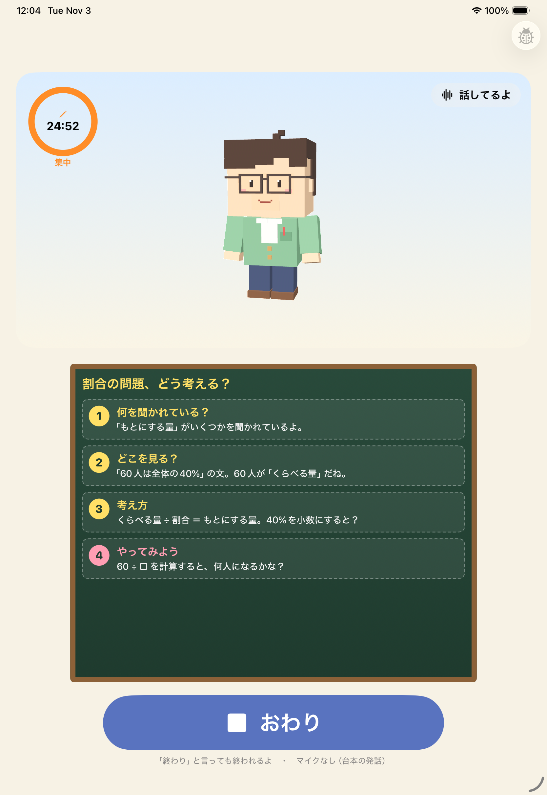
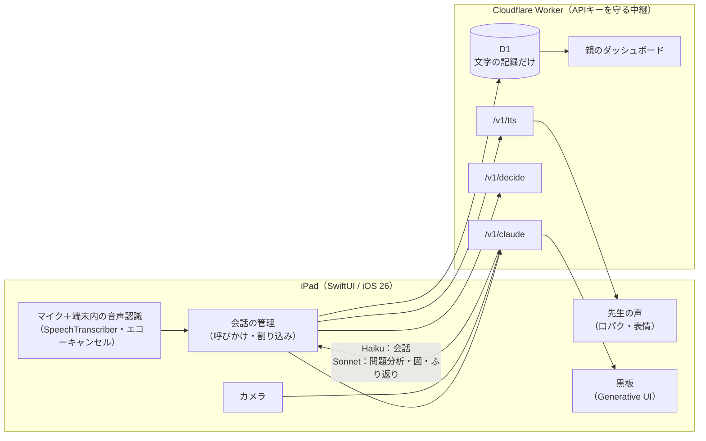

# AI家庭教師（仮）

一人で勉強する孤独を解消する、iPad の向こうに「一緒に頑張ってくれる先生」がいる家庭学習アプリ。

共働きで親が手を離せない朝や夕方、子どもが声で話しかけると、ボクセル風の先生が見守り、わからないところは**答えを言わずにヒントと図で**導いてくれます。

[Built with Claude: Japan 2026](https://cerebralvalley.ai/events/~/e/built-with-claude-japan2026) 参加作品です（概要は [docs/submission.md](docs/submission.md)）。

## できること

- **声だけで会話**：キーボード不要。「ねえ先生」で話しかけ、先生が話している途中でも割り込める
- **「これ見て」で問題を見せる**：撮影した問題を Claude が読み取り、答えを言わずに段階的なヒントを出す。最後のひと言は子どもに言わせる
- **図で説明**：手順カード・線分図・面積図・数直線・表・グラフなどを黒板に出す（Generative UI）
- **そばにいる先生**：うなずき・考え中・ほめるなどの表情と、声に合わせた口の動き
- **時間の声かけと雑談**：集中25分＋休憩5分。休憩中は雑談もできる
- **覚えている**：前回の内容や好きなことを覚えていて、始まりと終わりにふり返る
- **親が見られる**：スマホの Web ダッシュボードで学習時間・取り組んだ問題・先生のひとこと。深刻な悩みの兆しは「要確認」として残る

写真と音声はどこにも保存しません。残すのは文字の要約だけです。

## 構成

| 役割 | 使うもの |
| --- | --- |
| 会話 | `claude-haiku-5-5`（文ごとにストリーミングして読み上げ） |
| 問題の読み取り・ヒント・図・ふり返り | `claude-sonnet-5-5`（strict tool use） |
| 速い判断（話しかけたか・言い終わったか・撮影の依頼か） | TypeSafe AI の Jev（Decision API） |
| 読み上げ | ElevenLabs（差し替え可能。使えないときは端末の声） |
| サーバー | Cloudflare Workers ＋ D1、Google ログイン |

## 動かす

[docs/setup.md](docs/setup.md) を参照。iPad の実機（iOS 26 以上）が必要です（マイク・カメラ・エコーキャンセルはシミュレーターでは動きません）。

## ドキュメント

- [提出用の概要](docs/submission.md)
- [デモ動画の台本](docs/demo-script.md)
- [セットアップ手順](docs/setup.md)
- [仕様書](docs/spec.md)
- [ビジョンと決定事項](docs/vision.md)
- [技術調査](docs/research-2026-11-03.md)
- [ハッカソン要項](docs/hackathon-guide.md)

## ライセンス

MIT
