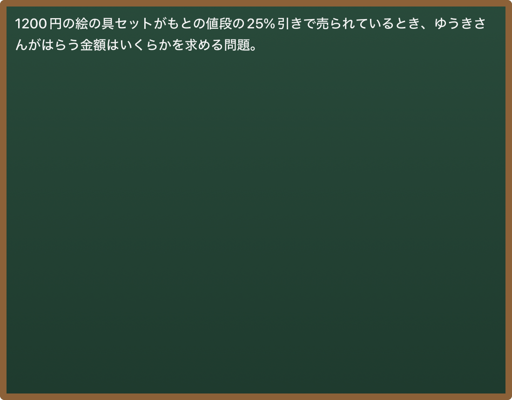
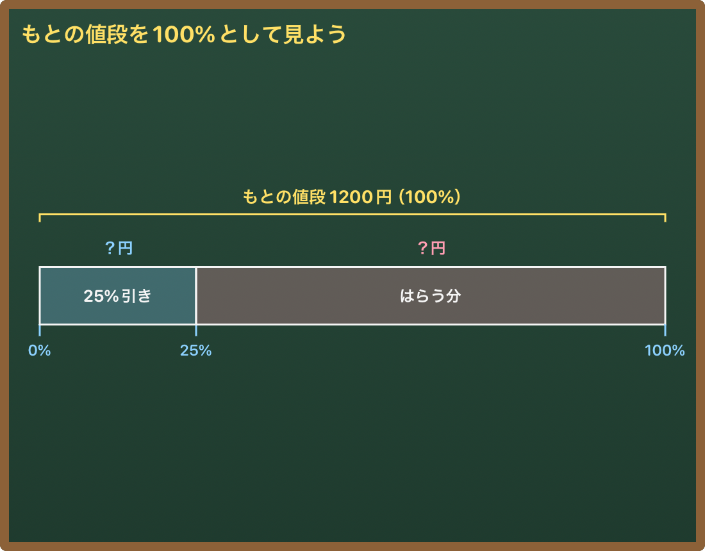
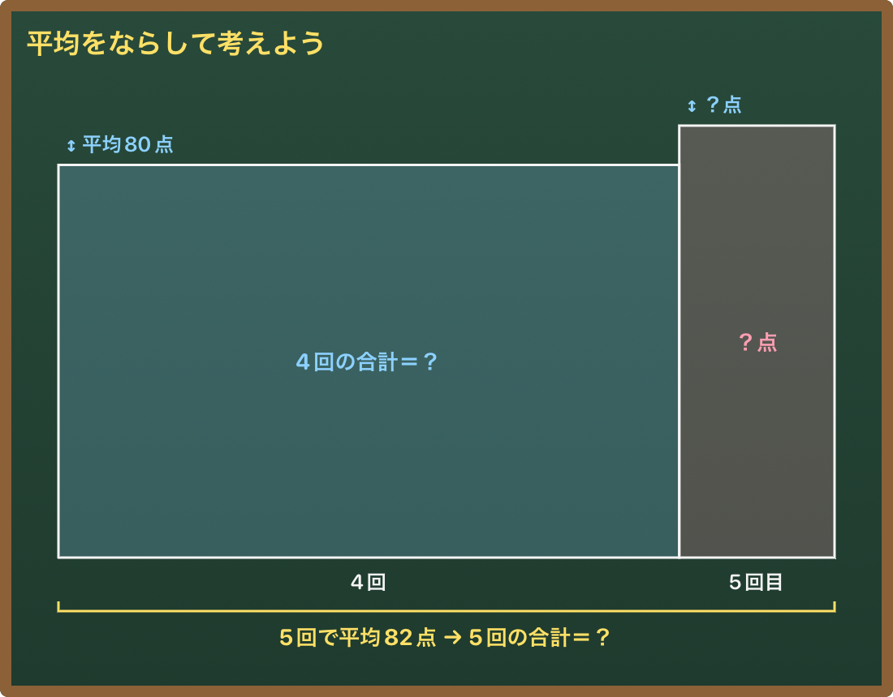
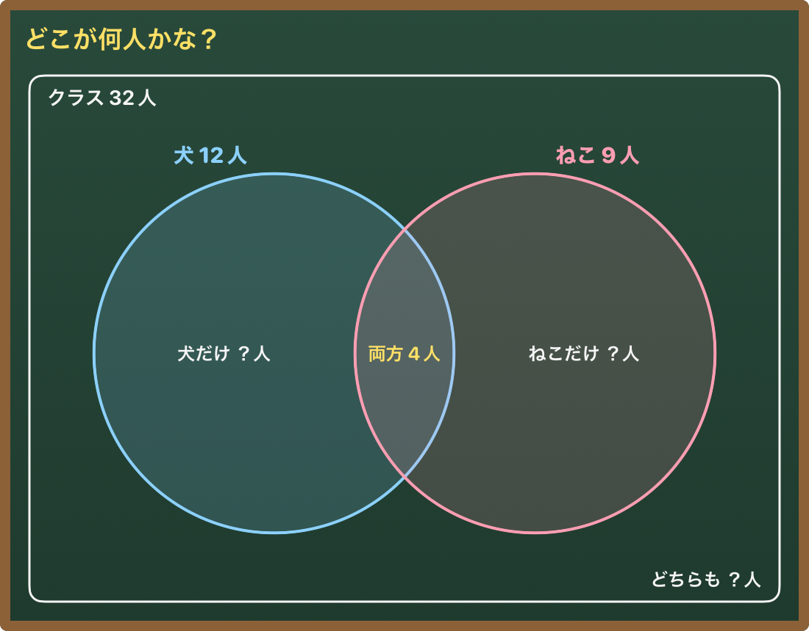
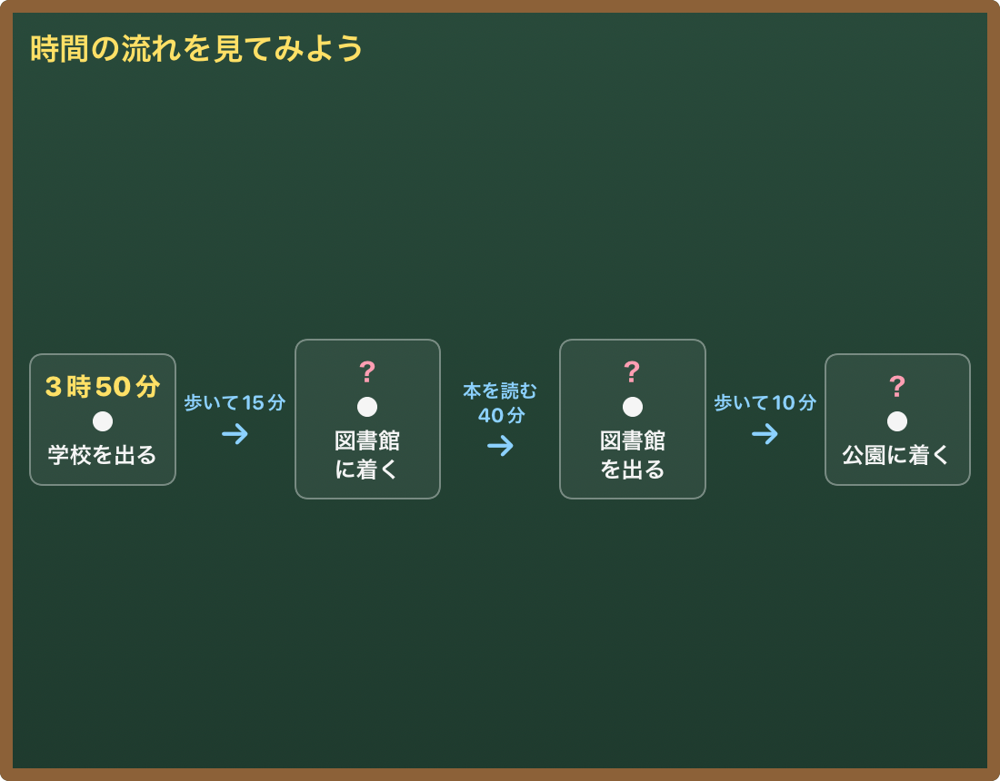

# 黒板（Generative UI）の評価

#70 で、適性検査風の問題 10 問（`evals/boards/cases.json`）について、本番の Worker 経由で Claude に黒板の図を作らせ、アプリの `BoardView` で描いて見た記録。

## やり方

```sh
# 1. Swift から、分析（Sonnet）に送る本文とツールを書き出す（ふだんのテストは食い違いだけ確かめる）
cd ios && TEST_RUNNER_BOARD_EXPORT=1 xcodebuild test ... -only-testing:HomeTeacherTests/BoardEvalTests
# 2. 本番の Worker に送り、ツールの入力を evals/fixtures/boards/<phase>/ に保存
WORKER_BASE_URL=... FAMILY_TOKEN=... node evals/boards.mjs --phase before
WORKER_BASE_URL=... FAMILY_TOKEN=... node evals/boards.mjs --phase before-ask --ask-board
# 3. シミュレーターで描いて docs/screenshots/boards-eval/<phase>/ に PNG を書き出す
cd ios && TEST_RUNNER_BOARD_EVAL=before xcodebuild test ... -only-testing:HomeTeacherTests/BoardEvalTests
```

- 本文はアプリの `ProblemAnalyzer.makeRequestBody` そのもの（システムプロンプト・ツール・`tool_choice: auto`）。違いは **写真のかわりに問題の文字を送る** ことだけ。写真を読む力は見ていない
- 画像はアプリと同じく「最初の図。図がなければ問題の要約の文字」を、画面の黒板と同じ 1100×860 で描く
- `before`：アプリのまま。`before-ask`：「黒板の図を1つ出して」と1文足したもの（図を出すかどうかとは別に、部品カタログの質を見るため）

## 改善前（2026-11-03）

### 1. 本番では分析そのものが失敗していた（直した）

アプリの分析リクエストは、本番の API で **毎回 400** だった。

> The compiled grammar is too large, which would cause performance issues. Simplify your tool schemas or reduce the number of strict tools.

- `show_board`（8部品の anyOf）を strict にしていたのが原因。`show_board` だけでも 400、部品ごとの小さなツール 8 つに分けても 400。`report_analysis` と `render_svg` は strict のままで通る
- 「これ見て」で撮影しても、いつも「写真がよく見えなかった」になっていたはず（シミュレーターのテストは MockTransport なので気づけなかった）
- 直し方：`show_board` だけ strict を外し、受け取った入力の足りないキー・型の違いは、スキーマから既定値で埋めてから読む（`SchemaDefaults`）。中身が空になったら文字で出す

### 2. 図が1枚も出ない（0/10）

400 を直しても、Sonnet は 10 問とも `report_analysis` だけを呼び、`show_board` / `render_svg` を呼ばなかった。黒板には問題の要約の文字だけが出る。



- 分析の指示（`ProblemAnalyzer.instructions`）は report_analysis のことしか書いておらず、図を出す場面・枚数の指示がない
- しかも図は撮影の直後に1回だけ。会話の途中（「もとにする量ってなに？」）では図が出る道がない

### 3. 頼めば出るが、表ばかり（before-ask：10/10 で図あり、うち 6 問が表）

| 問題 | 部品 | 良い | 悪い |
| --- | --- | --- | --- |
| 01 割合（25%引き） | 線分図 | 1200円＝100% と「はらう分＝？」の帯で、割合の関係が見える | テープの名前が左で切れる（「との値段」「ールの日」）、右の合計も切れる。上半分だけで下が空く |
| 02 速さ（出会う） | 線分図 | 兄・弟・合わせて1周、の3本 | 名前が切れる。反対向きに歩くのに、どのテープも左から始まる（出会う図にならない） |
| 03 L字の面積 | SVG | 切り取る部分を点線で示し、答えは「？cm²」 | 明朝体になり、ほかの部品と字の感じが違う |
| 04 規則性 | 表 | 1・2・3個 → 4・7・10本、10個は「？」 | 「いくつずつ増える？」が図にない（差の矢印がほしい） |
| 05 グラフの読み取り | 表 | 前の月と並べて「何倍？」の列 | 問題は「グラフ」なのに棒グラフにしない。強調（桃色）が多すぎてどこを見るかわからない |
| 06 資料の比較 | 表 | 1か所あたりの人数の列を「？」に | 字の表で、量の違いが目で見えない |
| 07 作文の構成 | 構成メモ | 2段落・書くことが「？」 | 上だけに寄って下が大きく空く |
| 08 平均 | 表 | 合計点を考えさせる | カタログは「平均は面積図」と言っているのに表。面積図の方が「たりない分」が見える |
| 09 集合 | 表 | 犬だけ・ねこだけ・両方・どちらでもない、に分ける | **ベン図がないので表になる**。重なりが目で見えない |
| 10 時間の流れ | 表 | できごとと時間を順に並べる | **時間の流れの部品がないので表になる**。強調が多い |

答えの漏れ（黒板に正答が書かれたもの）は 0/10。05・06 は答え（7月・B町）が選択肢として表にあるだけで、漏れではない。

### まとめ（直すこと）

1. 分析で図を必ず1枚出す（指示とプロンプト）。会話（Haiku）でも、図で伝わるときだけ図を出す
2. カタログの穴を埋める：**ベン図**、**時間の流れ（タイムライン）**、**割合の帯図**（もとにする量・くらべる量・割合）。グラフの読み取りには棒グラフ（注目する棒・差の注釈）を使うよう例を足す
3. 線分図のはみ出し（名前・合計）、図が上に寄って下が空く、表の強調が多すぎる、を直す
4. 一度に全部見せず、ヒントの段階・話している文に合わせて1つずつ見せる
5. カタログ（`prompts/board_catalog.md`）に、問題の型ごとの良い例・悪い例を書く

## 改善後（2026-11-03）

やったこと：分析で図を必ず1つ頼む（#81）、部品を3つ足す（`percent_bar` 割合の帯図・`venn_diagram` ベン図・`timeline` 時間の流れ）、カタログに「問題の型ごとの良い例・悪い例」と「表は最後の手段」を書く、線分図のはみ出し直し、SVG の既定の字を丸ゴシックにする。`after` は **アプリのまま**（`--ask-board` なし）で送った。

| | 改善前（アプリのまま） | 改善前（図を頼んだとき） | 改善後（アプリのまま） |
| --- | --- | --- | --- |
| 図が出た問題 | 0/10 | 10/10 | **10/10** |
| 表になった問題 | - | 6/10 | **2/10**（規則性・資料の比較） |
| 黒板に答えが漏れた | 0/10 | 0/10 | 0/10 |

| 問題 | 改善前（図を頼んだとき） | 改善後 |
| --- | --- | --- |
| 01 割合 | 線分図（名前がはみ出す） | **割合の帯図**：1200円＝100%、25%引き／はらう分 ？円、下に 0・25・100% |
| 02 速さ | 線分図（どのテープも左から） | 線分図：「池1周」1本を「兄が歩いた分 ？m」「弟が歩いた分 ？m」に区切る |
| 03 L字の面積 | SVG（明朝体） | SVG（丸ゴシック）。切り取る部分を点線、「残り＝？cm²」 |
| 05 グラフ | 表（強調が多すぎる） | **棒グラフ**（問題の数そのまま） |
| 08 平均 | 表 | **面積図**：4回×平均80点と5回目「？点」、「5回で平均82点 → 5回の合計＝？」 |
| 09 集合 | 表 | **ベン図**：犬だけ ？人・両方 4人・ねこだけ ？人・どちらも ？人 |
| 10 時間の流れ | 表 | **時間の流れ**：3時50分 学校を出る → 歩いて15分 → ？ 図書館に着く → … |

| 割合 | 平均 | 集合 | 時間の流れ |
| --- | --- | --- | --- |
|  |  |  |  |

### 残っていること

- グラフの読み取り（05）は棒グラフになったが、「前の月の何倍？」の注釈（矢印・差）がない。棒グラフに注釈を足すのは次の候補
- 速さ（02）は「反対向きに歩いて出会う」動きまでは見えない（`render_svg` のアニメなら描ける）
- 写真ではなく文字で送っているので、写真を読む力（撮影した問題の数を読み違えないか）は見ていない。実機での確認が要る
- 会話（Haiku）の図は `evals/run.mjs` の `board-*` ケースと `-autoSession` で見ている（#81）
